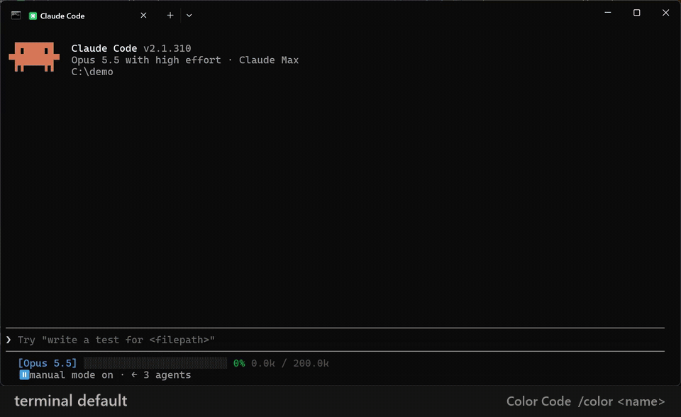
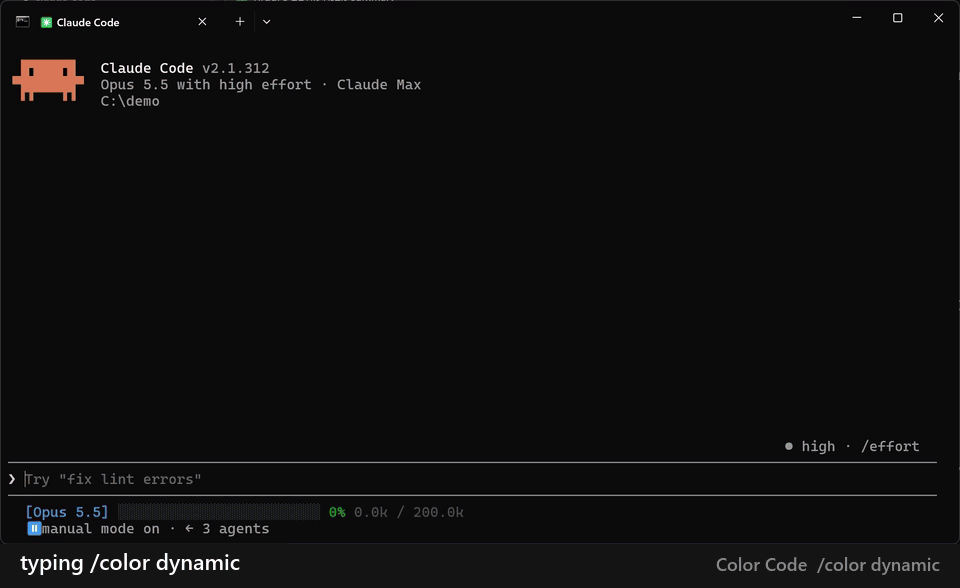
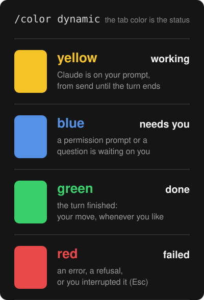

# Color Code

Make `/color` in Claude Code color the **whole terminal tab**, not just the prompt bar.

Run `/color yellow` and the session's tab turns yellow: a yellow-tinted
background, a re-lit terminal palette, and (in Windows Terminal) the tab and
the title bar. Every tab keeps its own color, so with several Claude sessions
open as tabs you can tell them apart at a glance. Or run `/color dynamic` and
the color tells you what each session is doing.



## Install

At the prompt of a terminal session:

```
/plugin install color-code --marketplace roykersh/color-code
```

Answer `y` to add the marketplace and pick the user scope. In Windows
Terminal, answer the one question Color Code asks to color your tabs too.
That's all: there is nothing to configure and nothing else to install.

From a shell instead: `claude plugin install color-code --marketplace roykersh/color-code`.
Sessions already open pick it up after a restart (`/exit`, then `claude -c`).

## `/color dynamic`: the color is the status

With `/color dynamic` the tab's color follows Claude, so a glance across your
tabs tells you which session needs you:

<table>
  <tr>
    <td width="70%"></td>
    <td></td>
  </tr>
</table>

Exactly when each color shows:

| Color | Means | When |
| --- | --- | --- |
| 🟨 **yellow** | working | from the moment you send a prompt until the turn ends |
| 🟦 **blue** | needs you | a permission prompt or a question (AskUserQuestion, an MCP form) is waiting on you, or the turn ended by asking you something |
| 🟩 **green** | done | the turn finished; your move whenever you like |
| 🟥 **red** | failed | the turn ended in an error, a refusal, or you interrupted it |

The same legend is printed in the session when you turn it on, a line per
color in the colors themselves, and again when a dynamic session is resumed.
`/color <name>` or `/color static` goes back to a fixed color. A resumed
session stays dynamic.

## What you get

- **8 colors**, one per `/color` choice: red, orange, yellow, green, cyan, blue,
  purple, pink. `/color default` puts everything back.
- **Dark and light.** Each color has a dark variant (tinted background, light
  text) and a light one (pale tint, near-black text). Color Code follows your
  Claude Code theme: with a light theme in `/theme` you get the light ones.
  `/color light`, `/color dark` or `/color auto` overrides that, for the
  session and as your default.
- **Readable on purpose.** Every palette is generated with contrast checks:
  every color stays at least 4.5:1 against its own background, and one that
  shares the theme's hue is pushed further so it never melts into it.
- **Per tab.** The colors go to that tab only. Exit Claude and the tab resets.
- **Resume keeps it.** `claude --resume` / `claude -c` brings the session's
  color (or dynamic mode) back.
- **Self-healing.** Drag a tab to another window or let Windows Terminal reload
  its settings and the colors come back: at once when the move changes the
  tab's width, otherwise within 3 seconds.
- **Auto color per project** (off by default): turn on `autoColor` in `/config`
  and a session nobody colored gets a stable color picked from its project
  folder, so the same repo always opens in the same color.
- **`/color` knows it all.** Its typeahead hint lists every word above, and a
  word it doesn't know gets that list back instead of an error.

## Commands

| Command | What it does |
| --- | --- |
| `/color <name>` | Color this session's tab. |
| `/color dynamic` / `static` | The color follows Claude's state (table above), or stops following it. |
| `/color light` / `dark` / `auto` | Pale or dark variants, or follow your Claude theme. |
| `/color default` | Back to the terminal's own colors. |
| `/color-code` | Status: the color, the variant, the terminal, the tab setup. |
| `/color-code setup` / `undo-setup` | Add or remove the Windows Terminal theme that colors tabs (the first-run question does `setup`). |

## Claude Code's own colors

Claude Code (2.1.x) reads its UI theme once, when a session starts, and gives
plugins no way to change it while the session runs, so `/color` can't recolor
Claude's own text, prompt border or mode labels. Color Code leaves that theme
alone: the terminal background, palette and tab carry the color. If you want
Claude's own accents to match one session, its themes are in `/theme` as
"Session red", "Session blue" and so on (note that `/theme` changes your
default for new sessions too).

## Tab progress ring

Claude Code draws its own progress ring in the tab (Windows Terminal, ConEmu,
Ghostty): a moving half circle while it works. Color Code leaves it alone, since
`/color dynamic` carries the state in the tab's color and two writers of one
ring only flicker. If you'd rather have Color Code's ring (spinning while
working, a full yellow ring while it waits on you), turn on the `activity`
option in `/config`, and turn off Claude's own with `terminalProgressBarEnabled`.

## Platforms

- **Windows Terminal**: everything, including the tab and title bar. The colors
  are sent by `bin/osc.exe`, a 6 KB helper built from `tools/osc.cs`, since a
  plugin's child process can't write to Claude Code's console directly.
- **macOS and Linux**: the colors go straight to the session's terminal
  (`/dev/tty`, or the tty of Claude Code itself) with no helper at all. Any
  terminal that takes OSC 10/11/12/4 works: iTerm2, Ghostty, kitty, WezTerm,
  Alacritty, GNOME Terminal and the other VTE terminals. **iTerm2** also gets
  a real colored tab. (Not verified on every one of these yet: reports welcome.)
- **tmux**: sequences are wrapped for passthrough and Color Code switches on
  `allow-passthrough` for its own pane (tmux 3.3+); the color then applies to
  the outer terminal window.

## Limits

- Claude Code's plugin API is early access: it can change between releases.
  Color Code leans on as little as it can, and every part fails soft.
- Windows Terminal keeps no per-tab color of its own that a program can set,
  so a tab's colors live in the terminal session itself and are lost when the
  tab moves to another window or the settings reload. Color Code repaints them
  (above); a moved tab can show its default colors for a moment.
- Light variants assume a light Claude theme: with a dark Claude theme, its
  light text would sit on a pale tab. `/color auto` (the default) avoids that.

## Customizing

Palettes are generated by `tools/gen_themes.py`: edit the hues or contrast
targets there and run `python tools/gen_themes.py`; it prints the lowest
contrast in each theme and refuses to write one under 4.5:1. Rebuild the
helper with `csc /target:exe /out:bin\osc.exe tools\osc.cs` (the C# compiler
that ships with Windows under `C:\Windows\Microsoft.NET\Framework64\v4.0.30319`).

Set `COLOR_CODE_DEBUG=1` to have the plugin log each step to `debug.log`.

## Roadmap

Ideas, roughly in order:

- Claude's own UI colors following `/color`, as soon as Claude Code lets a
  plugin switch the theme of a running session.
- Name on the tab: show the session's `/rename` name as the terminal tab title.
- Per-project color file: a `.claude/color` a team commits so a repo opens in
  its color for everyone.
- Dynamic palettes of your own (pick the four state colors).
- High-contrast and colorblind-safe sets.
- VS Code and JetBrains terminals (they ignore most OSC color sequences today).

## License

MIT
